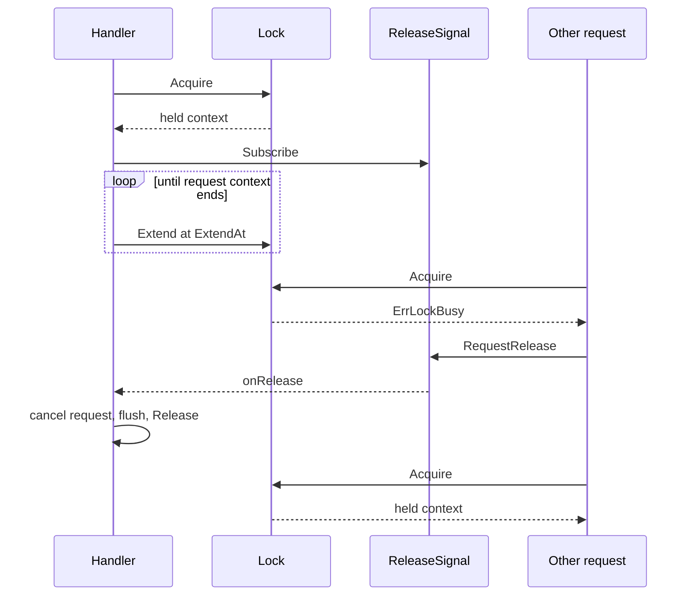

# Proposal: lease-based locker interface

Status: proposal for the next major release. Tracks [tus/tusd#1111](https://github.com/tus/tusd/issues/1111). This file is a design note, not a page on the documentation site.

This document specifies the `handler.Locker` API that should replace the current mutex-shaped interface. It is the contract for `memorylocker`, `filelocker`, and external lockers (etcd, Redis, and a future S3 conditional-write locker). It does not implement that change.

## Summary

A lock becomes a lease. The handler is the only thing that renews it, and the lease carries a context that dies when exclusive access is gone. Asking another request to abort stays a separate signal, so a lease backend and a notification backend can be different systems.

```go
// Locker creates unacquired lock handles for upload IDs.
type Locker interface {
    // NewLock builds a handle for id. id is an opaque upload ID and may
    // contain slashes. NewLock must not acquire, renew, or delete a lease
    // and must not block on the lock backend.
    NewLock(id string) (Lock, error)
}

// Lock is one lease hold for a single upload. It is not safe for concurrent
// use, except that Extend and Release may run at the same time.
type Lock interface {
    // Acquire takes the exclusive lease once.
    //
    // ctx bounds that single attempt. On success, held is a new context,
    // not a child of ctx, and cancelling ctx does not cancel held. held is
    // cancelled when this hold ends: Release returns, Extend fails, or the
    // implementation observes that the lease is gone. The cause is
    // ErrLeaseLost. Callers must not cancel held.
    //
    // A busy lease returns ErrLockBusy. Acquire does not wait for the
    // holder to finish and does not ask the holder to abort.
    //
    // On success the caller must follow ExtendAt. Acquire does not start a
    // renewal loop. On failure Acquire leaves no lease behind and held is nil.
    Acquire(ctx context.Context) (held context.Context, err error)

    // ExtendAt is when the holder should next call Extend. The zero time
    // means the lease does not expire and the handler must not call Extend.
    // It is valid after a successful Acquire and after each successful Extend.
    // It is earlier than the real backend expiry, leaving room for one slow
    // Extend (a third of the remaining lifetime is a good default).
    ExtendAt() time.Time

    // Extend pushes this hold's expiry forward and advances ExtendAt.
    // A lost, replaced, or expired hold returns ErrLeaseLost and cancels
    // held. Extend is safe to call at the same time as Release.
    Extend(ctx context.Context) error

    // Release ends this hold and cancels held. It removes only the lease
    // acquired by this handle, so a late Release after expiry must not
    // delete a newer holder's lease. A second call returns nil. A network
    // error is returned when the backend may still consider this hold
    // active; held is cancelled either way.
    Release(ctx context.Context) error
}

// ReleaseSignal asks the request that currently holds a lock to abort.
// Aborting that request is what releases the lease. The signal does not
// itself acquire or release anything.
//
// The same concrete type may implement Locker and ReleaseSignal. A different
// type may be installed when notifications use another system than the lease.
type ReleaseSignal interface {
    // Subscribe registers onRelease for id. The registration is visible to
    // RequestRelease before Subscribe returns. cancel removes it and is
    // idempotent. onRelease may run on another goroutine, may run more than
    // once, and must return quickly. It may still be running when cancel
    // starts, and it must not be called after cancel returns.
    Subscribe(id string, onRelease func()) (cancel func())

    // RequestRelease tells the holder of id to abort. It does not take the
    // lease. It returns nil when the caller should retry Acquire: the signal
    // was delivered, the holder is already gone, or a backend-specific
    // backoff has elapsed. It returns ctx.Err() when ctx ends first.
    RequestRelease(ctx context.Context, id string) error
}
```

Two sentinels accompany the interface:

```go
// ErrLockBusy means a single Acquire found the lease already held.
// The handler retries. This value is not an HTTP error and must not be
// written to the client.
var ErrLockBusy = errors.New("tusd: upload lock already held")

// ErrLeaseLost means this request lost exclusive access before it finished.
// The held context is cancelled with this cause. The handler returns it to
// the client as 500 so the upload is resumed instead of continued.
var ErrLeaseLost = NewError(
    "ERR_LEASE_LOST",
    "lost exclusive access to this upload before the request finished",
    http.StatusInternalServerError,
)
```

`ErrLockTimeout` stays the handler's acquire-deadline error. Lockers return `ctx.Err()` when their one attempt is cut short. They do not invent the timeout.

## Why the current interface does not fit

`Lock` today is a mutex plus a callback:

```go
Lock(ctx context.Context, requestUnlock func()) error
Unlock() error
```

That matches `memorylocker`: an in-process map, a channel closed on `Unlock`, and a direct call to `requestUnlock`. It does not match a lease.

- A mutex is valid until `Unlock`. A lease expires while the process is alive and wedged, or after the process dies. Nothing in the interface renews a lease, and nothing tells the handler that the lease has already been lost. Storage calls keep using the request context, so they continue after exclusive access is gone.
- `Unlock` has no context, so a distributed release cannot bound its own RPC.
- `requestUnlock` is delivered by the locker. Every backend has to grow a side channel. `filelocker` polls a sibling `.stop` file. The Redis locker in [#1129](https://github.com/tus/tusd/pull/1129) added a `LockExchange` for pub/sub. The etcd locker never grew a channel at all.
- The handler cannot own the renewal loop. [#1129](https://github.com/tus/tusd/pull/1129) starts `keepAlive` inside `Lock`. On failure it calls `releaseRequested` only because that happens to cancel the request. [The review](https://github.com/tus/tusd/pull/1129#discussion_r2128628638) calls this out: lease loss should reach the handler directly, and the interface cannot express that yet. The same gap is what [#1111](https://github.com/tus/tusd/issues/1111) asks to close. [A later comment on that PR](https://github.com/tus/tusd/pull/1129#issuecomment-2993757680) asks for the lock to return a context for the same reason.

The shipped etcd locker ([`tus/tusd-etcd3-locker`](https://github.com/tus/tusd-etcd3-locker)) shows the same drift. It still imports `github.com/tus/tusd/pkg/handler` and implements `Lock() error`, so it does not satisfy the v2 interface. `NewLock` opens an etcd session, and `concurrency.Session` keepalives until `Unlock`. A handler that has stopped making progress still renews the lease for as long as the process stays up.

Renewal belongs to the handler so it stops when request handling stops. Process death already ends an in-process goroutine. The case the API has to make structural is a live process whose request was cancelled, wedged, or returned: no further `Extend` runs, and the lease then expires on its own even if `Release` never does. `Release` remains the fast path for an orderly handoff. The TTL is the backstop.

## Handler behavior

`lockUpload` is the only renewal loop. Embedders keep configuring a `Locker` and do not acquire locks themselves.

Resolution of the signal, in order:

1. `StoreComposer.ReleaseSignal`, when set via `UseReleaseSignal`.
2. The `Locker` value, when it implements `ReleaseSignal`.
3. No signal. The handler retries `Acquire` until `AcquireLockTimeout`, sleeping `lockPollInterval` (one second) between attempts.

```go
func (h *UnroutedHandler) lockUpload(c *httpContext, id string) (Lock, error) {
    lock, err := h.composer.Locker.NewLock(id)
    if err != nil {
        return nil, err
    }

    acquireCtx, cancelAcquire := context.WithTimeout(c, h.config.AcquireLockTimeout)
    defer cancelAcquire()

    signal := h.releaseSignal()
    var held context.Context
    waits := 0
    for {
        held, err = lock.Acquire(acquireCtx)
        if err == nil {
            break
        }
        if !errors.Is(err, ErrLockBusy) {
            if errors.Is(err, context.Canceled) || errors.Is(err, context.DeadlineExceeded) {
                return nil, ErrLockTimeout
            }
            return nil, err
        }
        // RequestRelease is supposed to block until a retry is useful. If there
        // is no signal, or a retry is still busy, poll so a signal that returns
        // immediately cannot spin until AcquireLockTimeout.
        if signal == nil || waits > 0 {
            timer := time.NewTimer(lockPollInterval)
            select {
            case <-acquireCtx.Done():
                timer.Stop()
                return nil, ErrLockTimeout
            case <-timer.C:
            }
        }
        waits++
        if signal == nil {
            continue
        }
        if err := signal.RequestRelease(acquireCtx, id); err != nil {
            if errors.Is(err, context.Canceled) || errors.Is(err, context.DeadlineExceeded) {
                return nil, ErrLockTimeout
            }
            return nil, err
        }
    }

    // Register before lockUpload returns, so a waiter that already saw
    // ErrLockBusy cannot miss the callback.
    if signal != nil {
        stop := signal.Subscribe(id, func() {
            c.cancel(ErrUploadInterrupted)
        })
        go func() {
            <-held.Done()
            stop()
        }()
    }

    // Swap the request context for a child that also ends when the lease
    // ends. PostFile, PostFileV2, HeadFile, PatchFile, GetFile, and DelFile
    // already pass c into the store, so every in-flight storage call observes
    // the loss without a second context argument at each call site.
    parent := c.Context
    c.Context = cancelWhen(parent, held)
    go keepLease(parent, held, lock)
    return lock, nil
}
```

`cancelWhen(parent, held)` returns a child of `parent`. Values stored on `parent` stay visible. The child is cancelled with `context.Cause(held)` when the lease context ends, and with the parent's cause when the request ends. Go's `WithCancelCause` does not propagate a parent cause on its own, so the helper has to copy `context.Cause` explicitly. `ErrLeaseLost` must survive that merge: `sendError` already uses `errors.As`, and `Error.Is` compares error codes.

`keepLease` returns when `parent` ends or `held` ends. Otherwise it waits until `ExtendAt`, then calls `Extend` with a background context whose timeout is the interval it just waited. The budget is detached from the request context so the graceful-completion window can still renew. `parent` is the delayed request context, which stays active for `GracefulRequestCompletionTimeout` after a disconnect or a release request. Renewal therefore covers the flush of a PATCH body, and it stops when that window ends or the lease context ends. `Extend` failure just returns. `held` is already cancelled, the storage call unblocks, and `defer Release` runs.

`Release` uses a short background timeout of a few seconds. Its error is logged. It does not replace the HTTP status of a request that already succeeded or already failed. A failed `Release` on an expiring lease heals itself at the TTL. A non-expiring lease (memory, file) has no such backstop, which is why the error is still logged.

`Subscribe` cancels the request with `ErrUploadInterrupted`. It does not cancel `held`. The holder still owns the lease while it flushes, which is the same delayed-cancel path `httpContext` uses today. Cancelling `held` at the moment of the request would drop exclusive access during that flush.



When `Extend` fails, or `ExtendAt` passes without a successful `Extend`, the implementation cancels `held` with `ErrLeaseLost`. The in-flight `PATCH` stops, and the client receives `500 ERR_LEASE_LOST` and resumes with `HEAD`.

## How the existing backends sit on this

| Backend | Acquire | ExtendAt | Release | Signal |
| --- | --- | --- | --- | --- |
| Memory | Insert into the map, or return `ErrLockBusy` | Zero | Compare-and-delete this entry, close its channel | `onRelease` plus the closed channel |
| File | `lockfile.TryLock` once | Zero, unless a later rewrite wants to recheck the PID file | `Unlock` and remove the `.stop` file | Create and poll the `.stop` file |
| etcd | `Grant` a lease and `TryLock`. Do not use `concurrency.Session` auto-keepalive | About a third of the lease TTL | `Revoke` that lease ID | Watch a sibling key, or any other shared bus |
| Redis (redsync) | `TryLockContext` once | Half of `Until()`, inside the real expiry | `UnlockContext` with the lock token, ignoring "already expired" | Short-lived pub/sub channel per upload, which is what [#1129](https://github.com/tus/tusd/pull/1129) moved to in production after one shared channel filled up |
| S3 conditional writes ([#1183](https://github.com/tus/tusd/issues/1183)) | `PutObject` with a failed precondition mapped to `ErrLockBusy` | Refresh the object's expiry with a conditional update | Delete the object only if the precondition still matches this hold | No native notify. Leave `ReleaseSignal` unset and let the handler poll |

`RequestRelease` owns the first wait. The file locker waits one poll inside `RequestRelease`. The memory locker invokes `onRelease` and waits for that hold's channel. The Redis exchange publishes and waits for the ack. The handler then retries `Acquire` immediately, so a signal that already waited is not delayed a second time. If that retry is still busy, the handler sleeps `lockPollInterval` before asking again, which caps a signal that returns without waiting.

`NewLock` staying local also fixes a leak in the etcd locker, which grants a session before `Lock` is called.

Upload IDs need escaping per backend. `projectA/upload1` is a legal tus id and a path in `filelocker`. Redis keys, etcd prefixes, and S3 object names should treat the id as a single opaque segment.

## Conformance tests

Ship `pkg/locktest` so `memorylocker`, `filelocker`, and the external module repos run one suite. Suggested entry point:

```go
func Run(t *testing.T, newLocker func() handler.Locker)
```

The suite covers:

- Two handles for one id: the second `Acquire` returns `ErrLockBusy` while the first is held, and it returns while the test's context still has most of its deadline left. `Acquire` must not block until the holder finishes.
- After `Release`, the second handle can `Acquire`.
- `Release` of a handle that never acquired returns nil.
- A second `Release` returns nil.
- Cancelling the `Acquire` context after success leaves `held` active.
- `Release` cancels `held` with `ErrLeaseLost`.
- `Extend` after `Release` returns `ErrLeaseLost`.
- `Release` only deletes its own hold. Acquire, `Release`, acquire with a second handle, then `Release` the first handle again. The second hold must still be busy for a third handle. This catches a locker that deletes by upload id.
- `Extend` is called in parallel with `Release`.
- When the locker implements `ReleaseSignal`: `Subscribe` is visible before it returns, `RequestRelease` runs `onRelease`, `RequestRelease` on an idle id returns nil, and `onRelease` does not run after `cancel` returns.

Expiring lockers take a constructor that sets a short TTL and pass two extra tests. With no `Extend` until past the TTL, `held` is cancelled with `ErrLeaseLost` and a later `Extend` returns `ErrLeaseLost`. After that expiry, a second handle can `Acquire`, and `Release` on the expired handle must leave the second hold in place. Both tests are opt-in so the memory and file lockers skip them.

## Migration

This is a v3 break. `Lock(ctx, requestUnlock)` and `Unlock()` go away together. There is no adapter that can renew a lease the old interface cannot name.

In-tree:

- Move the types from `datastore.go` to `pkg/handler/locker.go`.
- `memorylocker` and `filelocker` implement `Locker` and `ReleaseSignal` on the same value. `UseIn` keeps registering only the locker. The handler discovers the signal.
- Replace the generated `FullLock` mock. Handler tests that expect `Lock` plus `Unlock` expect `Acquire`, `ExtendAt`, and `Release`. A non-expiring test double returns a background context from `Acquire`, a zero `ExtendAt`, and cancels that context in `Release`.
- `lockUpload` swaps `httpContext.Context` as above. `defer lock.Unlock()` becomes `defer release(lock)`.
- Rewrite [the locks page](../docs/_advanced-topics/locks.md) when the implementation lands. This note stays out of the documentation site.

Out of tree, against this contract:

- [`tus/tusd-etcd3-locker`](https://github.com/tus/tusd-etcd3-locker) needs a v3 module path, `TryLock` plus `KeepAliveOnce`, and a real release signal. It does not build against v2 today.
- The Redis work in [#1129](https://github.com/tus/tusd/pull/1129) and the maintained fork under [`CDCgov/data-exchange-upload`](https://github.com/CDCgov/data-exchange-upload/tree/main/upload-server/pkg/redislocker) drop their internal keepalive goroutine. `LockExchange` becomes a `ReleaseSignal`. Whether that lives in `tus/tusd-redis-locker` ([#1399](https://github.com/tus/tusd/issues/1399)) is a packaging decision, not an interface decision.
- S3 locks ([#1183](https://github.com/tus/tusd/issues/1183)) can implement `Locker` alone.

Calling `requestUnlock` from a failed `Extend` is the pattern to delete. `Extend` cancels `held`, and the handler already treats that as a failed request.

`filelocker` should stop returning `ErrNotFound` when the upload id's parent directory is missing. That couples the locker to `filestore`'s layout. The current code already has a TODO for it. The v3 rewrite is the right time. Stale `.lock` and `.stop` files on SMB ([#1372](https://github.com/tus/tusd/issues/1372)) stay a file-locker bug. A lease TTL does not clean up lock files left by a dead process.

## Deferred

These came up around the same issues and are intentionally outside this API.

**Read and read-write leases.** [#1111](https://github.com/tus/tusd/issues/1111) asks whether `GET` and `HEAD` could take a shared lock so downloads proceed in parallel. Shared leases are not a feature of etcd, Redis, or S3 conditional writes, and a read lock that is a no-op would hide real races on offset reads. `HEAD` and `GET` keep the exclusive lease. tusd's download path remains a convenience, which is the conclusion already recorded on that issue.

**A general inter-instance bus.** `ReleaseSignal` is only the abort request that today's callback performs. A wider messaging system can be a new interface when a second caller exists.

**Fencing tokens.** Cancelling `held`, and plumbing that context into storage calls, is the fence: a stale owner stops writing. A token method (`etcd` revision, Redis lock value, Azure lease id) can be an optional interface later without changing `Lock`. Azure blob leases ([discussed on #1119](https://github.com/tus/tusd/issues/1119)) still need an upload-level lock around `GetInfo` plus `WriteChunk`. A store-private lease does not cover that span. No no-op locker is required for them.

**Making a locker mandatory.** That is [#1119](https://github.com/tus/tusd/issues/1119). `UsesLocker` stays optional. This proposal does not pick a default.

## Alternatives considered

**Keep `requestUnlock` on `Acquire`, and add `Extend` plus a context.** This is the smallest edit to today's signature, and it still leaves every backend implementing its own side channel. The Redis PR invented `LockExchange` anyway. A separate `ReleaseSignal` makes that side channel swappable and makes "S3 leases with no notification" a normal configuration: the handler polls.

**Let `Acquire` block until the lease is free.** That is `etcd` `Mutex.Lock` and today's memory locker. The handler then cannot interleave `RequestRelease`, and a busy lock looks like a timeout. One non-blocking attempt, with the wait loop written once in `lockUpload`, gives every backend the same deadline and the same handoff behavior.

**Renew inside the locker until the request context ends.** The interval would sit naturally next to the TTL, and the handler could not forget to call `Extend`. It is also how the etcd session mis-renews: the keepalive is tied to the process, or to a context the locker chose, rather than to handler progress. An explicit `Extend` is observable in handler tests and stops as soon as `keepLease` returns. `ExtendAt` keeps the margin policy inside the locker, which is the part that actually knows the TTL, without handing it the loop.

**Return `<-chan struct{}` for lease loss instead of a context.** A channel cannot be passed to `GetUpload` or `WriteChunk`. The context can, which is what makes a lost lease interrupt the storage call.

**Expose `RenewWithin() time.Duration` instead of `ExtendAt()`.** A duration is easy to fake in tests, and it drifts relative to the true expiry if `Extend` itself is slow. A timestamp lets the locker recompute the deadline from the backend's clock after every renewal. Non-expiring locks return the zero time, and the handler skips the loop.
